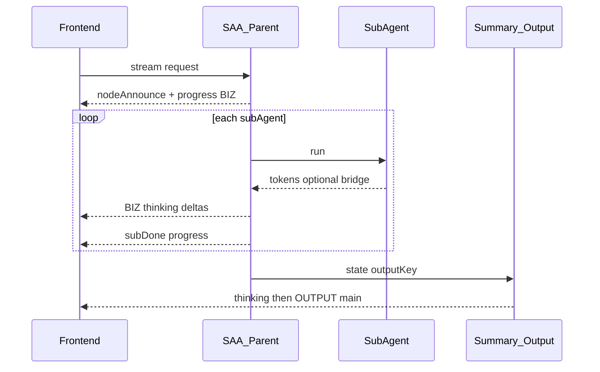

# ace-graph SAA 等待期静默优化设计

## 目标与非目标

**目标**：SAA 执行期间主对话有可见进展（进度文案 / 可选子增量），用户不以为卡死。

**非目标**（本设计不做）：
- 扩展新 SSE 事件类型（遵守 Q6「不改协议」）
- Cursor/harness 式独立子会话产品形态
- 缩短终答墙钟时间（终答仍：子跑完 → 汇总/输出）

与 Cursor/harness 对齐的是「**等待期可见**」，不是「主会话终答提前」。

## 选定方案：父节点 Facade 进度 + Token 桥接（两阶段）

约束：所有对外帧仍走现有 Lesso SSE（`node` / `delta` / `deltaThinking` / `heartbeat`），`nodeId` 固定为 **SAA 父节点**，`responseKind` 用父 `saaSpec.streamResponseKind`（默认 BIZ）。子 Agent 不单独占一条 OUTPUT。

### 阶段 P0：生命周期进度（必做，低风险）

在 [`FlowAgentNodeAction`](ace-graph-dsl/ace-graph-dsl-backend/ace-graph-dsl-saa-agent/src/main/java/io/acelance/graph/dsl/saa/FlowAgentNodeAction.java) / Sequential 变体中接入图执行上下文里的 `GraphStreamBridge` + `runId`（今日 SAA 模块未使用 bridge，这是缺口）。

每个子 Agent：
1. **开始前**：`emit` 一条短文本 TokenChunk（父 nodeId、父 responseKind），内容如「正在执行：意图分析…」
2. **结束后**：再 emit「已完成：意图分析（xx ms）」
3. **空闲保护**：若单子超过阈值（如 5s）无其它 emit，父侧补 progress 或依赖宿主已有 heartbeat（[`AceGraphLessoPlatformSseAdapter`](lesso-ai-project/lesso-ai-platform-agent-server/src/main/java/com/lesso/ai/platform/acegraph/web/AceGraphLessoPlatformSseAdapter.java) 已有 `heartbeat` 能力时可复用链路）

展示通道：父 BIZ + 业务 `thinking:true`（与现网深度思考气泡一致），**不进正文 OUTPUT**，避免进度污染终答。

记忆：进度帧 **不**触发 `WRITE_USER` / ASSISTANT 落盘；子仍 NONE（Q5 不变）。

### 阶段 P1：子 token 桥到父（体验拉齐 Cursor「看得见在动」）

在 [`GenericAgentBaseAgentAdapter`](ace-graph-dsl/ace-graph-dsl-backend/ace-graph-dsl-saa-agent/src/main/java/io/acelance/graph/dsl/saa/GenericAgentBaseAgentAdapter.java) 执行委托时，把子路径的流式 bridge 重定向为：

- `TokenChunk.nodeId` = **父 SAA nodeId**
- `responseKind` = **父 streamResponseKind**
- token 原文可带轻量前缀或仅透传（默认透传；UI 靠 P0 的「正在执行 xxx」区分阶段）

实现要点：
- 子内部若仍 `invoke` 无流，需改为可走 `StreamingLlmTemplate` 的 stream/bridge 路径，或在 adapter 层挂 `ObservingGraphStreamBridge` 转发
- 子完成结果仍只写 binding `outputKey`；**禁止**子 `WRITE_*`
- 桥接增量进 thinking Buffer 时，与现网 `WRITE_ASSISTANT_THINKING` 汇总节点策略对齐：SAA 期桥接默认只推 SSE、**不** remote add ASSISTANT（避免多条气泡）

### 阶段不纳入：独立子会话 UI

设计器试运行已有 `ace.graph.dsl.saa.subSteps` 树，继续加强即可；线上对话不做第二会话面板（产品与协议成本过高）。

## 行为与文案约定

| 时机 | 用户可见 | 落盘 |
|------|----------|------|
| SAA 等待期 | 父 BIZ/thinking：进度 +（P1）子增量 | 无 ASSISTANT；USER 仍按图节点写意图 |
| 汇总节点 | thinking 整理 | `WRITE_ASSISTANT_THINKING`（± USER） |
| 输出节点 | 正文 OUTPUT | `WRITE_ASSISTANT_MAIN_TEXT` |

## 关键改动面

- 框架：`ace-graph-dsl-saa-agent`（Action/Adapter 接 bridge；子流重定向）
- 图执行：确认 SAA `toAction` 能拿到与 GenericAgent 相同的 `runId`/bridge（从编译挂载或 `LlmRequestContext` 透传）
- 宿主：基本不改 SSE 字段；必要时为 SAA 父节点配 thinking 的 bizParam，使进度进思考气泡
- 文档：更新 Q6 附录——「不扩展事件类型；允许父 BIZ 承载进度/桥接增量」

## 验收

1. 复杂 SEQUENTIAL（≥2 子、单子 >10s）：主对话在 SAA 期间持续有 thinking/进度帧，无 >5s 完全静默  
2. 一轮 remote 仍 1 USER + 1 ASSISTANT（记忆规则不回归）  
3. 终答正文仍只来自 OUTPUT 节点，不含「正在执行…」进度句  
4. 关闭 bridge/进度开关（若加配置）时行为回退为今日 invoke 静默
